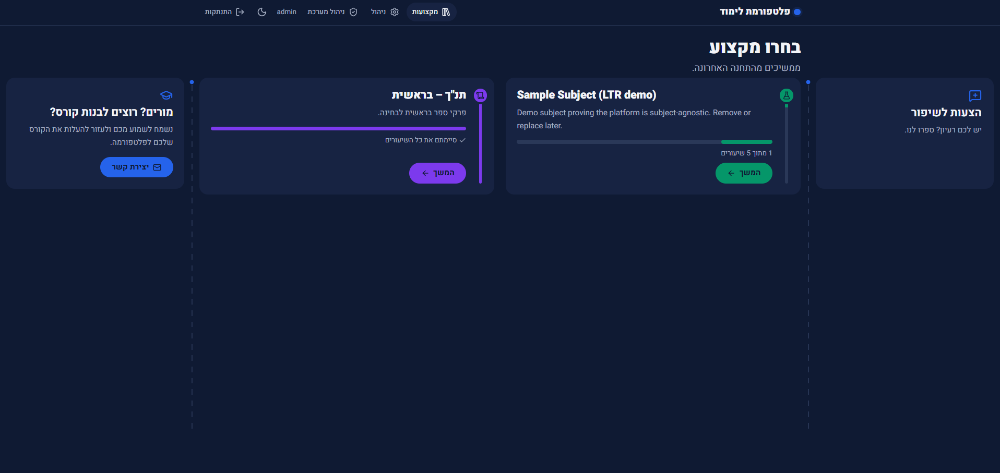
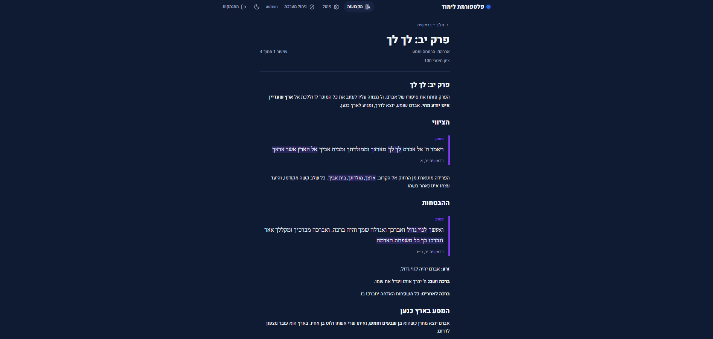
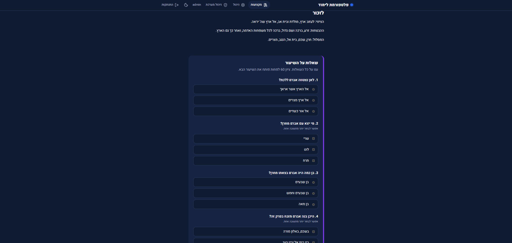
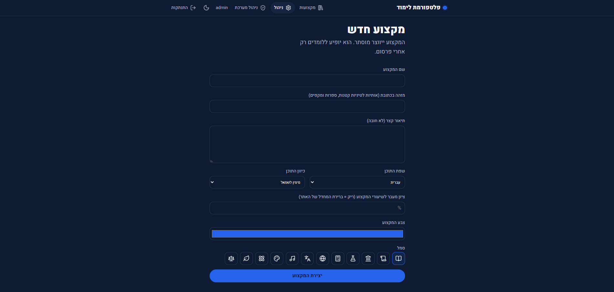

# Study Platform

A web app for studying a subject one lesson at a time. A learner picks a subject, reads a lesson,
answers the questions at the end of it, and a passing score opens the next lesson. Teachers build
the subjects in the app itself: sections, lessons, lesson text and questions, with a draft and
publish step so learners never see half-finished work.

The interface is Hebrew and right-to-left; each subject sets its own
content language and direction, so an English left-to-right subject sits next to a Hebrew one.



## What it does

**For learners**

- Join a subject and follow its path: sections in order, lessons in order inside each section.
- Read lessons made of headings, paragraphs, quoted sources with highlighted phrases, images
  and lists.
- Answer the lesson's questions, with one or several correct answers per question. The result
  shows the score, which answers were wrong, and the correct ones.
- Retake a lesson as often as needed. The best score is kept and nothing ever locks again.
- Light and dark theme.

| A lesson                                      | Its questions                                              |
| --------------------------------------------- | ---------------------------------------------------------- |
|  |  |

**For teachers (the `ADMIN` role, at `/admin`)**

- Create subjects with a language, direction, accent colour, icon and default passing score.
- Build the structure: add, rename, delete and drag sections and lessons into order.
- Write lessons in a block editor with a live preview and image upload.
- Write the questions for each lesson and mark the correct answers.
- Everything is saved as a draft and goes live when the subject is published.



**For the site owner (the `SYSTEM_ADMIN` role, at `/system-admin`)**

- Find any account, change its role, disable it, lift a lockout, and read its login history.
- Read the improvement suggestions learners send and mark their status.
- Change site settings: open or close registration, the teacher contact email, how many
  suggestions a user may send per day, and the image upload size limit.

## Stack

React Router v8 (framework mode, server rendering, middleware), React 19, TypeScript in strict
mode, Prisma 7 on MariaDB, zod for all validation, argon2 for passwords, Tailwind v4 with shadcn
components alongside hand-written CSS, and Vitest.

## Running it

You need Node 24 or newer and Docker Desktop (for the local MariaDB).

```bash
cp .env.example .env        # then edit SESSION_SECRET and SEED_ADMIN_PASSWORD
npm install
npm run db:up               # MariaDB in Docker on localhost:3307
npm run db:deploy           # apply the migrations
npm run db:seed             # the admin account and two demo subjects
npm run dev                 # http://localhost:5173
```

Sign in with `SEED_ADMIN_USERNAME` and `SEED_ADMIN_PASSWORD` from your `.env`, or register a new
account at `/register`.

The seed creates two demo subjects, one Hebrew and one English. Their lessons hold placeholder
text that exercises every block type, and three lessons carry a short quiz.

The database listens on host port **3307** so it does not clash with a MySQL already installed
on 3306.

## How it is organised

```
Subject → Section → Lesson → Question → QuestionOption
```

- **Lesson content** is a JSON array of typed blocks, validated by zod on every read and write.
  Image blocks reference an uploaded asset, and a used asset cannot be deleted.
- **Drafts.** Edits to lesson text and questions are stored as drafts. Publishing a subject
  copies them live in one transaction; a subject with an invalid draft is left untouched.
- **Progression.** The first lesson of the first section is open. Passing a lesson opens the
  next one; finishing a section opens the next section. The rules live in one file,
  `app/shared/unlock.ts`.
- **Passing score.** A lesson's own score, else its subject's default, else
  `DEFAULT_LESSON_PASSING_SCORE`. The score of a quiz is the percent of fully correct questions.
- **Roles.** `USER` is a student, `ADMIN` is a teacher, `SYSTEM_ADMIN` also manages users and
  settings. One guard on the root route protects everything except an explicit list of public
  paths, and every loader and action checks the role again.
- **No subject in the code.** Subject names and content live only in `prisma/seed-data/`;
  `npm run lint` fails if one leaks into `app/`.

Code layout: `app/routes/` pages, `app/components/` UI, `app/schemas/` zod schemas shared by
both sides, `app/shared/` pure helpers, `app/server/` server-only code with one folder per
domain, `prisma/` schema, migrations and seed, `tests/` mirroring `app/`.

The design documents are in `docs/superpowers/specs/`, and `docs/superpowers/plans/` holds the
build log.

## Configuration

Every variable is described in `.env.example` and validated at startup by `env.schema.ts`. The
app refuses to start on an invalid or missing value.

| Variable                                       | Default                    | Meaning                                                    |
| ---------------------------------------------- | -------------------------- | ---------------------------------------------------------- |
| `DATABASE_URL`                                 | (required)                 | MariaDB connection string                                  |
| `SESSION_SECRET`                               | (required, 16+ characters) | Signs the session cookie                                   |
| `SESSION_EXPIRY_HOURS`                         | 720                        | Sliding session life                                       |
| `SESSION_TOUCH_INTERVAL_MINUTES`               | 5                          | Minimum gap between session activity writes                |
| `AUTH_FAILURE_WINDOW_MINUTES`                  | 15                         | Window for counting login failures                         |
| `AUTH_USERNAME_MAX_FAILURES`                   | 5                          | Failures per username before a temporary lockout           |
| `AUTH_USERNAME_LOCKOUT_MINUTES`                | 15                         | Lockout length                                             |
| `AUTH_IP_MAX_FAILURES`                         | 20                         | Failures per IP before an IP block (must exceed the above) |
| `AUTH_LOG_RETENTION_DAYS`                      | 30                         | `npm run cleanup` deletes older login log rows             |
| `AUTH_REGISTER_MAX_PER_IP`                     | 5                          | Registrations allowed per IP within the window             |
| `AUTH_REGISTER_WINDOW_MINUTES`                 | 60                         | Window for counting registrations                          |
| `TRUSTED_PROXY_COUNT`                          | 0                          | Trusted `X-Forwarded-For` hops (see below)                 |
| `DEFAULT_LESSON_PASSING_SCORE`                 | 60                         | Percent, when lesson and subject set no passing score      |
| `STORAGE_PROVIDER`                             | `local`                    | Asset storage backend                                      |
| `STORAGE_LOCAL_DIR`                            | `./storage`                | Where the local provider writes files                      |
| `UPLOAD_MAX_BYTES`                             | 5242880                    | Largest image upload. Default for the site setting         |
| `CONTACT_EMAIL`                                | empty                      | Teacher contact address. Default for the site setting      |
| `SUGGESTIONS_MAX_PER_DAY`                      | 5                          | Suggestions per user per day. Default for the site setting |
| `SEED_ADMIN_USERNAME` / `_PASSWORD` / `_EMAIL` | `admin` / (set it) / empty | The seeded `SYSTEM_ADMIN`                                  |

The three "default for the site setting" values apply until a system admin saves the settings
page; after that the saved values win.

## Security

- **Passwords and sessions.** Passwords are hashed with argon2id. Sessions are rows in the
  database behind a signed cookie with sliding expiry; disabling an account ends its sessions.
- **Login protection.** Every login attempt is logged. After `AUTH_USERNAME_MAX_FAILURES`
  failures a username is locked for a while, even if the next password is right. After
  `AUTH_IP_MAX_FAILURES` failures an IP is blocked, for 15 minutes at first and up to 24 hours
  for repeat offenders. The IP limit is higher because many students share one school address.
- **Registration.** Limited per IP, and it can be closed entirely from the settings page.
- **No hints.** Every failed login or registration returns the same message, so the forms never
  reveal whether a username exists.
- **Uploads.** The image type is read from the file's own bytes, never from what the browser
  claims, and the size is capped.

This guards against password guessing. It is not protection against request floods, which belong
at the reverse proxy or network layer.

**Behind a reverse proxy,** set `TRUSTED_PROXY_COUNT` to the number of proxy hops you control
(usually `1`). With the default `0` the app never trusts `X-Forwarded-For`, records the client
address as `unknown`, and only the username lockout applies. The `unknown` address is never
blocked or throttled.

Run `npm run cleanup` on a schedule to delete expired IP blocks and old login logs, for example:

```
0 3 * * * cd /srv/study-platform && npm run cleanup
```

In development, `docker/mariadb-init/` gives the database user server-wide privileges so
`prisma migrate dev` can create its shadow database. Production uses `prisma migrate deploy`,
which needs none.

## Extending it

**A new subject** needs no code: sign in as an `ADMIN`, create it at `/admin`, add sections and
lessons, write the content and questions, and publish from `/admin/publish`. If a subject ever
seems to need its own route or component, that is a gap in the platform to fix for all subjects.

**A new kind of content block:**

1. Define its schema in `app/schemas/content-blocks.ts` and add it to the `ContentBlock` union.
2. Add a renderer in `app/components/lesson-content/blocks/`.
3. Register it in `app/components/lesson-content/LessonContent.tsx`. The build fails until you do.
4. No migration is needed: existing lessons stay valid.

## Testing

```bash
npm run db:up
npm test
```

Tests live in `tests/`, mirroring `app/`. Database tests wipe every table, so they always run
against a separate database, `study_test`, in the same container (`tests/setup.ts` forces
`DATABASE_URL`; override it with `TEST_DATABASE_URL`). Create and migrate it once:

```bash
docker exec schoolearn-db-1 mariadb -ustudy -pstudy -e "CREATE DATABASE IF NOT EXISTS study_test;"
npm run db:test:migrate
```

Run `npm run db:test:migrate` again after adding a migration. The development database is never
touched by tests.

## Not built

Streaks (attempt timestamps and a per-user time zone are already stored), two-factor login,
cloud storage for uploads, email verification and password reset. Where one of these has a
natural place in the code it is marked `TODO(<feature>)`.
